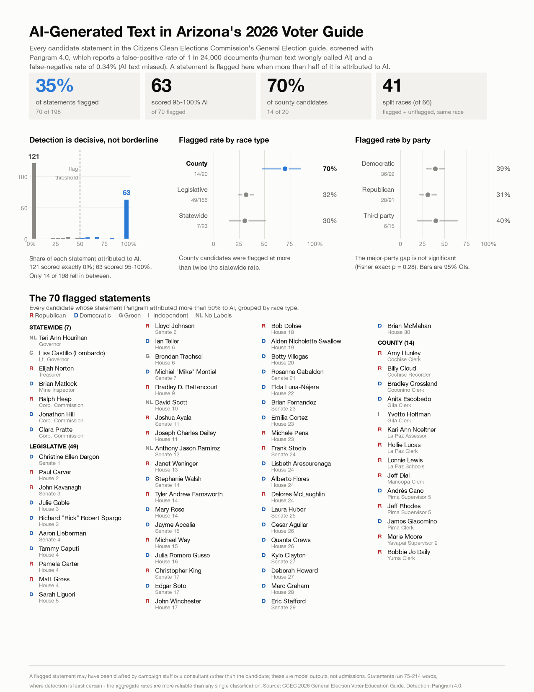

# AI-generated text in Arizona's 2026 Voter Education Guide

I screened every candidate statement in the Arizona Citizens Clean Elections
Commission's **2026 General Election Voter Education Guide** for AI-generated
text with the [Pangram](https://www.pangram.com) detector. To measure the
detector's false-positive rate on this exact kind of text, I then screened the
same Commission's **2022** guide, which was written before ChatGPT existed.

This is an independent personal project. It is not affiliated with or endorsed by
any employer, institution, campaign or party.

## Results

**70 of 198 statements in the 2026 guide (35%) were flagged as predominantly
AI-written** (Pangram attributes more than half the text to AI).

| | Flagged | Rate | 95% CI |
|---|---:|---:|---|
| **2026, all races** | 70 / 198 | 35% | 29–42% |
| 2026, county | 14 / 20 | 70% | 48–85% |
| 2026, legislative | 49 / 155 | 32% | 25–39% |
| 2026, statewide | 7 / 23 | 30% | 16–51% |
| 2026, Democratic | 36 / 92 | 39% | 30–49% |
| 2026, Republican | 28 / 91 | 31% | 22–41% |
| **2022 control (pre-ChatGPT)** | **0 / 149** | **0%** | **0–2.5%** |

- **The scores are decisive, not borderline.** 121 statements scored exactly 0.00
  and 63 scored 0.95 or higher; only 14 fell in between.
- **The party difference is not statistically significant** (Fisher exact p = 0.28).
- **County candidates were flagged at more than twice the statewide rate.**
- **The detector did not flag any pre-ChatGPT statement.** Every one of the 149
  statements in the 2022 guide was labelled human-written.
- **The same people flagged in 2026 were not flagged in 2022.** 59 candidates
  appear in both guides. Six of them are flagged in 2026, and all six scored 0.00
  on their own 2022 statements (exact McNemar p = 0.031). Their 2026 flags are
  not explained by a writing style the detector already reacted to.

To check any candidate, open the spreadsheet,
[`AZ_voter_guide_AI_screen.xlsx`](AZ_voter_guide_AI_screen.xlsx). It has every
candidate, score and statement, with live summary formulas and charts.

## Limitations

- **The two years were scored by different model versions.** The 2026 statements
  were scored on September 20, 2026 with Pangram 4.0. The 2022 control was scored
  on October 20, 2026 with Pangram 4.1, because the `pangram-4` model selector had
  moved to 4.1 and 4.0 could no longer be selected. The 0% false-positive rate
  therefore belongs to 4.1. It is strong evidence about this genre of text, but
  not a measurement of 4.0.
- **The 2022 control covers statewide and legislative races only**; the 2022 guide
  had no county races. Its comparisons with 2026 exclude the 20 county statements.
- **The 2022 guide prints biography and statement as one block**, while the 2026
  guide separates them and only the statement was scored. Length does not explain
  the gap: 2022 flagged 0% of statements under 150, 150–199 and 200+ words,
  while 2026 flagged 27%, 32% and 33%.
- **The Commission may have edited lightly for layout.** The guide says
  statements were reproduced as submitted, but that "non-substantive editing may
  have occurred for layout purposes."

## Data

| File | Contents |
|---|---|
| `data/candidate_statements_scored.csv` | 2026: all 208 candidates, statement text, Pangram scores |
| `data/control_2022/candidate_statements_scored.csv` | 2022: all 152 candidates, statement text, Pangram scores |

`candidate_id` encodes the PDF page and the candidate's order on it (`p020-1`;
`g22-` prefix for 2022). PDF pages are one-based and run two higher than the
page numbers printed in the 2026 guide. A statement counts as flagged when
`pangram_fraction_ai > 0.50`; that threshold is mine, not Pangram's.

## Sources

- 2026 General Election Voter Education Guide:
  <https://storageccec.blob.core.usgovcloudapi.net/public/docs/1509-1497AllDistrictWebEnglishv2.pdf>
- 2022 General Election Voter Education Guide:
  <https://storageccec.blob.core.usgovcloudapi.net/public/docs/821-Website-ENGLISH--VEG-General-2022.pdf>

## Method

[`scripts/extract_statements.py`](scripts/extract_statements.py) pulls each
candidate's statement out of the 2026 guide's PDF. The pages share one layout,
so the parser keys off each `Party: … Funding: … Website: …` line.
[`scripts/run_pangram.py`](scripts/run_pangram.py) sends every statement to
Pangram's bulk API as one job and joins the scores back by candidate. Both
scripts use only the Python standard library plus `pdftotext`
(`brew install poppler`):

    python3 scripts/extract_statements.py       # 2026 PDF (in repo root) -> data/
    python3 scripts/run_pangram.py --dry-run    # cost estimate, no network
    python3 scripts/run_pangram.py              # billed; needs PANGRAM_API_KEY

## License

The code in `scripts/` is released under the [MIT License](LICENSE). The data,
spreadsheet and figure are released under
[CC BY 4.0](https://creativecommons.org/licenses/by/4.0/): reuse them freely, with
credit to Luke Basler. The candidate statements themselves come from the
Commission's public voter guides.
